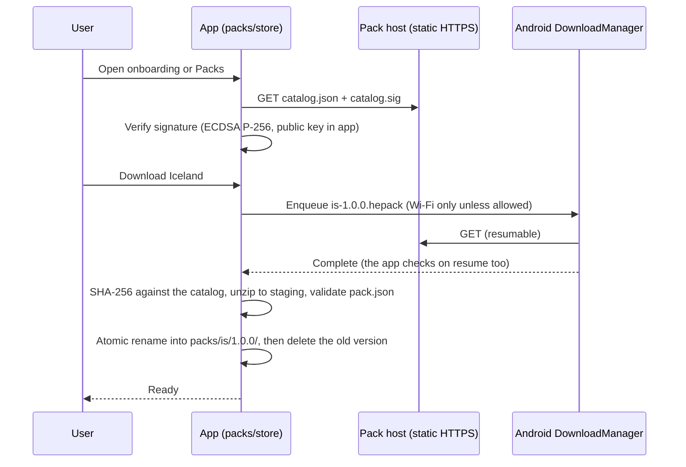

# MyFirstVisit — Architecture

Status: **draft, app and production compiler not built.** Python gates exist for the earlier
Iceland text shape, traveler-research dossier and research-backed guide sources. Iceland now has
the dossier, briefing, playbooks and routes required for an editorial draft; human and release
gates remain pending.
The architecture below is planned. How the app is put together, what it takes from
`../card_games`, how country packs are delivered and stored, and where it departs from the
`card_games` platform rules.

## Relationship to card_games

MyFirstVisit is a separate Gradle root (`apps/first-day-away/`) and a separate app, built
the same way as the card games:

- Android only (v1), Kotlin and Jetpack Compose for the application shell and interactive
  tools; Android WebView for installed semantic-HTML guide articles. Custom Canvas drawing is
  used only where a native feature genuinely needs it, not for document layout.
- The same toolchain: checked-in Gradle wrapper, JDK 17 toolchain, Gradle 9.5.0, AGP 9.3.1,
  Kotlin Compose plugin 2.3.20, compileSdk 36.1, minSdk 26, targetSdk 36, configuration and
  build cache on. (Copied from `card_games/AGENTS.md` on 2026-10-09; check it again when
  scaffolding.)
- The same conventions: specs in `docs/` are the contract; `buildSrc` convention plugins and
  build gates; `.\gradlew.bat check` runs tests, lint and the gates; debug code in `src/debug`;
  release with R8 and resource shrinking.
- The same licensing: PolyForm Noncommercial 1.0.0, `COPYRIGHT.txt`, and the rule that a
  shipped dependency may only be Apache 2.0, MIT or BSD.
- Publisher FinitePlay LLC, app ID `org.finiteplay.myfirstvisit`.

### What is taken, and how

Shared code is **copied once at scaffold time** into this repo, with the `card_games` revision
it came from recorded in the copied module's README. There is no composite build linking the two
repos, for three reasons. `card_games` `core/ui` mixes game-neutral code with card rendering.
Its gates are written around games. And the `card_games` rule is to extract shared code only
once two real users prove the shape. This app is that second user: once both copies have
settled, the parts still identical are candidates for a shared FinitePlay library.

| From `card_games` | To | Change |
|---|---|---|
| `core/storage`: `PreferencesDataStores`, `AppLocale`, the `ActiveGameRecordStore` pattern | `core/storage` | The record store becomes the optional practice-session record store (below) |
| `core/ui/theme`: `Theme.kt` structure, `ThemeMode`, `SolarClock`, `ZoneCoordinates` | `core/ui/theme` | New palette ([UI_SPEC.md](UI_SPEC.md)); the four theme modes kept |
| `core/ui` `ContrastTest` | `core/ui` tests | Pinned to the new palette |
| `core/ui/sound`: `SoundPlayer`, `AndroidSoundPlayer`, `GatedSoundPlayer` | `core/ui/sound` | Unchanged; used for interface cues only |
| `core/ui/res/raw`: `sound_hint`, `sound_invalid`, `sound_action_confirm`, `sound_round_win`, `sound_win` | `core/ui/res/raw` | Unchanged; provenance rows copied into `docs/SOUND_ASSETS.md` |
| `core/ui/layout`: `SettingsRows`, `SettingLabels`, `AboutSettingsGroup`, `FullScreenPanel`, `ResultBanner`, `Confetti`, `HumanDuration`, `StatusTextStyles` | `core/ui/layout` | About gains audio and photo credits |
| `core/cards` `SplitMix64` | `practice/engine` | Only the PRNG; no cards |
| `buildSrc` convention plugins and the gate pattern | `buildSrc` | New gates (below) |
| Gradle wrapper, `.gitattributes`, `.gitignore`, `LICENSE.txt`, `COPYRIGHT.txt` layout | root | — |
| `docs/APP_ICON_STYLE.md` family rules | [UI_SPEC.md](UI_SPEC.md) "App icon" | New mark |

Not taken: card rendering (`CardArt`, `FeltTable`, `CardColors`), card gestures, deal pickers,
hints, the solitaire layer, solvers, statistics, level-up and rest reminders.

## Module map

```
core/storage    DataStore helpers, locale override, optional-practice record    (Android)
core/ui         theme, sound cues, settings and About scaffolding, banner,      (Android)
                shared strings and the article-reader chrome
packs/model     pack data types, pack.json schema v1, parsing, validation       (pure Kotlin/JVM)
packs/store     catalog, download, verify, install, update, delete, list        (Android)
guide/model     article metadata, routes, evidence labels and indexes            (pure Kotlin/JVM)
practice/engine opt-in sessions, deterministic exercise generation, reducer     (pure Kotlin/JVM)
app             native screens, navigation, restricted WebView host, audio, mic (Android)
tools/packs     content/<cc>/ → pack file + catalog; the verifyPacks gate      (desktop only)

content/<cc>/   pack sources (CONTENT.md); not a Gradle module, never in the APK
tools/content/  research audit, source validators and preview renderers; not a Gradle module
```

Dependencies run one way:

```
app → guide/model → packs/model
app → practice/engine → packs/model
app → packs/store  → packs/model
app → core/ui, core/storage
tools/packs → packs/model
```

Gates in `buildSrc`, wired into `check`:

- **`assertPureKotlin`**: `packs/model`, `guide/model` and `practice/engine` have no Android
  dependency, so pack navigation and optional-practice logic are unit-tested on the JVM and portable to iOS later
  (Kotlin Multiplatform).
- **`assertAppExcludesTools`**: `tools/packs` never reaches the app's runtime classpath (the
  `card_games` `assertAppExcludesSolver` pattern).
- **`verifyPacks`**: rebuilds every pack in `content/` and checks it against the rules in
  [CONTENT.md](CONTENT.md) "Pack source and build". It does not publish anything.

`python tools/content/audit_research.py <research-dir> --strict` checks dossier structure,
recency/diversity floors, source-role fit, topic support, anecdote context, sensitive-topic
verification and the recorded saturation judgment. `python tools/content/validate.py` still
checks the earlier Iceland text structure and can render its preview. Neither is `verifyPacks`:
they do not compile archives, validate the runtime schema, measure media, prove editorial
quality or replace traveler-task review.

`python tools/content/audit_guide.py <country-dir>` currently checks the transitional briefing,
playbook and route inventories, their evidence references, and the playbook and route
completeness standard in `CONTENT.md` (length, structured choice, actions, live checks,
traveler stories and source roles; route days, bases and season notes). The production replacement also
parses and validates semantic HTML. Both are structural, not prose-quality gates.

## Country packs

### The pack file

One file per country per content version, `<cc>-<version>.hepack`, a zip:

```
pack.json        article index, places, language toolkit and optional practice
content/         compiled, sanitized semantic-HTML guide articles and shared CSS
audio/           Ogg Vorbis clips, named as in CONTENT.md
img/             licensed briefing/place photos and illustrations
CREDITS.json     every audio and image file: author, licence, source, SHA-256
```

`pack.json` (abridged):

```json
{
  "schema": 1,
  "country": "IS",
  "packVersion": "1.0.0",
  "researchedAsOf": "2026-10-10",
  "audiences": ["en-US:first-time"],
  "features": { "practice": true },
  "language": { "tag": "is-IS", "name": "Icelandic", "stress": "first-syllable" },
  "languageNote": "Nearly everyone in Iceland speaks excellent English…",
  "replacedSlots": [{ "slot": 17, "reason": "Iceland has no railways" }],
  "phrases": [
    {
      "id": "p05", "slot": 5, "category": "courtesy",
      "local": "Takk fyrir", "romanization": null, "respelling": "TAHK FIH-rihr",
      "ipa": null, "meaning": "Thank you",
      "when": "The everyday thanks; takk alone is fine too",
      "formality": "neutral",
      "audio": { "normal": "audio/p05_normal.ogg", "slow": "audio/p05_slow.ogg" }
    }
  ],
  "articles": [
    {
      "id": "is-start-here", "kind": "briefing", "title": "Start here",
      "path": "content/is-start-here.html", "readingMinutes": 15,
      "audiences": ["en-US:first-time"], "topics": ["arrival", "weather"]
    }
  ],
  "places": [ … ],
  "primer": { "intro": null, "rules": [ … ], "signWords": [ … ] },
  "scenarios": [ … ],
  "practice": { "sessions": [ … ] }
}
```

The full authoring corpus and raw anecdotes do not ship by default. Compiled sections retain
their evidence label, material source links, freshness, audience fit, limitations and live
handoffs. This keeps packs small without severing reader trust or the update path.

The app accepts `schema` values it knows. A newer schema shows the pack as *Needs an app
update* in the pack manager, rather than failing.

### Guide rendering: native shell, offline WebView

Compose owns onboarding, tabs, pack management, filters, Saved, Places, Language, Show a local,
Practice, settings and all system integration. The guide detail screen contains native top and
bottom chrome around a WebView that renders one installed article. HTML owns document flow—
headings, paragraphs, figures, captions, traveler accounts, comparisons and callouts—but does
not own application navigation, downloads, storage, permissions or arbitrary native APIs.

This is a content renderer, not an embedded general-purpose browser:

- Serve verified installed-pack files through `WebViewAssetLoader` on the reserved
  `https://appassets.androidplatform.net/` origin. Never load guide content with `file://`, and
  set file and content access off.
- JavaScript is disabled for v1 guide articles. Native actions use compiler-approved links
  intercepted by the host, such as save, play a local audio clip, open a native place card or
  open a map. Unknown actions fail closed.
- Allow navigation only to the current installed pack. HTTPS links in source content are
  labeled as external and handed to the system browser after an explicit user action; all
  other schemes and redirects are rejected.
- Compiled pages receive a restrictive Content Security Policy: default deny, with styles,
  images, fonts and media limited to the installed pack origin as required. They contain no
  forms, iframes, remote resources, service workers, pop-ups or downloads.
- Do not add a broad `addJavascriptInterface`. If a later feature truly requires scripting,
  specify its message schema, origin check and threat model first, then expose the smallest
  possible capability through a versioned bridge.
- Pack signatures and hashes establish which archive was installed; the compiler's HTML
  allowlist and reference validation establish what is safe to render. Both gates are required.
- Shared versioned CSS maps semantic article classes to the app themes and reserves image
  aspect ratios to prevent reflow. Article-specific inline styling is not allowed.
- WebView debugging is enabled only in debug builds. Cache, history, cookies, DOM storage,
  geolocation, camera and microphone access are unnecessary for article rendering and remain
  disabled. Clearing or deleting a pack cannot leave a readable stale copy in a web cache.

The reader reports stable article/section IDs—not scroll-pixel positions—to the native state
store. Back first follows the native navigation model; it never exposes an internal browser
history. Process recreation reopens the article and nearest stable section. Saved state never
depends on the generated DOM order.

### Delivery (recommended): static files over HTTPS

Packs and a catalog are static files on a plain HTTPS host (object storage behind a CDN). There
is no server code, no account, and nothing is sent but the file request.



- **Catalog**: per pack, the country, version, size, SHA-256, minimum app schema, and
  language. Signed so that a compromised host cannot serve altered content; HTTPS alone covers
  the transport.
- **Download** uses the system `DownloadManager`. It resumes, survives the app being closed,
  respects the Wi-Fi-only choice, and is a system service, so the app runs no background
  service or job of its own.
- **Install** is atomic: unzip into `filesDir/packs/.staging/`, validate, then rename into
  `filesDir/packs/<cc>/<version>/`. A failed or partial install leaves the previous version
  untouched.
- **Updates** are offered, never applied by themselves. The catalog is fetched only when the
  user opens onboarding or the pack manager, and no network call happens anywhere else.
- **Delete** removes the files and keeps progress, so a re-download picks up where the user
  left off.

**The alternative, Play Asset Delivery** (on-demand asset packs): Play hosts and downloads the
packs, and there is no server to run. Against it: content updates ship only with an app release,
it is Android-only, and its client library's licence is outside the Apache/MIT/BSD rule. That
would need a recorded exception. This is open question 2 in [DESIGN.md](DESIGN.md).

## Guide model and optional practice engine

`guide/model` and `practice/engine` are pure Kotlin and hold no Android or I/O code. The guide
model indexes article metadata and native actions; it does not parse a live DOM or contain an
HTML renderer. WebView configuration and link interception stay in the Android app.

- **Guide indexes.** Briefings, playbooks, routes and places are indexed by audience, trip mode,
  season, region and stable topic IDs. Filters reorder or hide cards; they never rewrite the
  evidence or silently strengthen a claim.
- **No content gates.** Every guide, place and language-reference item is directly reachable.
  Reading state supports resume and history only.
- **Deterministic optional practice.** A practice session's cards (exercise types, order,
  distractors) are built from `(pack version, session id, seed)` with `SplitMix64`. Reference vectors pin the output for
  known seeds, as `card_games` pins its shuffle. A change that moves them needs a new generator
  version.
- **One reducer** owns every transition: `answer`, `selfRate`, `skip`, `continue`. State is
  immutable. A missed item may be re-queued only within the user-started practice session.
- **Practice memory** per language item id is separate from reading and saved state. No quiz
  result represents destination readiness.

## Persistence

The `card_games` rules apply: save asynchronously after every committed action (here, every
answer), every settings change, and every move to the background. Use an atomic, versioned
format. A corrupt save is discarded without touching the others.

| Store | Holds | Keyed by |
|---|---|---|
| Settings (DataStore) | Every setting in [UI_SPEC.md](UI_SPEC.md) | — |
| Guide state (DataStore, one per pack) | Last-open item, selected audience/trip/season filters, saved items, saved taxi address | Country + stable content ids |
| Practice state | Optional language-item memory and completed user-started sessions | Country + stable language ids |
| Active practice record | Pack id + version, session id, seed, generator version, answer log | — |

- An active practice session is restored by **replaying its answer log**, as `card_games`
  restores a game.
- Guide and practice state are keyed by stable item ids, not positions, so they survive pack
  updates and deletes. If an update removes a saved item, retain a tombstone until the user
  dismisses it rather than silently redirecting to different advice.
- No timer is persisted. Reading-time estimates are editorial metadata, not countdowns.

## Audio

- **Phrase clips**: an optional practice session preloads its clips into a `SoundPool` for
  under 150 ms from tap to sound and releases them when it closes. Guide, Language and Places
  play individual clips through `MediaPlayer`.
- **Routing and quiet mode**: `AudioManager.getDevices(GET_DEVICES_OUTPUTS)` plus an
  `AudioDeviceCallback` tell whether headphones (wired, USB, Bluetooth A2DP/LE) are connected.
  Unplugging mid-practice stops playback and turns quiet mode on, the same as a music player.
- **Recording (Say it)**: `AudioRecord` into an in-memory buffer of at most 8 s, played back with
  `AudioTrack` and then dropped. `RECORD_AUDIO` is requested the first time the user taps the
  mic, never at start-up. If it is refused, *Say it in your head* takes over.
- **Interface cues** go through the copied `GatedSoundPlayer`, exactly as in `card_games`.

## Where this app departs from card_games/docs/PLATFORM.md

Each departure is deliberate. `docs/PLATFORM.md` for this app, written at scaffold time,
records them as its own rules.

| `card_games` rule | Here | Why |
|---|---|---|
| No networking | Pack catalog and download only, user-initiated, through `packs/store` and `DownloadManager`. `INTERNET` permission. No other network code (a gate greps for HTTP clients outside `packs/store`) | Packs must be downloaded |
| Screen readers out of scope | In scope ([UI_SPEC.md](UI_SPEC.md) "Accessibility") | The content is text and audio, not a spatial board |
| All sound gated by a Sound setting, default off | Interface cues stay gated and off by default. Phrase audio follows quiet mode instead | Phrase audio is the content |
| 31 interface languages | US English only in v1. Strings are still resources, and the locale-completeness gate stays in place for later | Transcriptions and tips are written for Americans |
| No permissions beyond the basics | `RECORD_AUDIO`, optional, on first use | Say it |
| — | Screen brightness raised while Show a local is open | Readable across a counter |

Everything else holds: no accounts, analytics, ads, background services, jobs, or wake locks,
and no personal data leaves the phone.

## Budgets

| Measure | Budget |
|---|---|
| App download | ≤ 15 MB (the `card_games` budget; expected far under, since content lives in packs) |
| Pack | ≤ 12 MB, enforced by `verifyPacks` |
| Cold start to interactive | ≤ 1.5 s at p95 |
| Card to card | ≤ 100 ms |
| Tap to sound | ≤ 150 ms |
| Memory | ≤ 120 MB PSS |
| Idle CPU | < 1%; nothing animates or polls while idle |

## Testing

- **Unit (JVM)**: pack parsing and validation (good, corrupt, newer schema), guide indexes and
  filter invariants, HTML compiler allowlist and reference validation, optional-practice
  generator vectors and reducer, persistence/replay and corrupt-save recovery.
- **Authoring tools**: research-audit unit tests; strict dossier audit; country source validator;
  `verifyPacks` over every compiled pack.
- **Instrumented, on an emulator**: onboarding against a local fake pack host (a test-only HTTP
  server); download, interrupt, resume, verify, install; Guide/Places/Language with the network
  off; confirm article loads make no remote requests; rejected navigation/schemes and unavailable
  bridge capabilities; a user-started practice session; quiet mode with and without headphones;
  TalkBack smoke runs through a playbook and practice; 200% text, both themes, rotation and
  process-death/section restore.
- **Before content approval**: evidence review, editorial rubric and 90-second traveler-task
  tests from `.agents/skills/verify-country-pack/`.
- **Before release**: the moderated traveler tests in [DESIGN.md](DESIGN.md) "What success
  looks like", plus native, safety, rights, accessibility and device gates.
