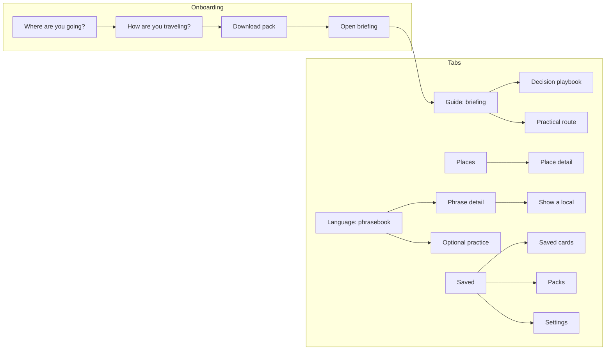

# MyFirstVisit — UI Specification

Status: **draft, app UI not built.** Screens, navigation, components and the visual system. What
the app does and why is in [DESIGN.md](DESIGN.md); what a pack contains is in
[CONTENT.md](CONTENT.md); research and editorial behavior is in
[EDITORIAL.md](EDITORIAL.md). This revision makes the briefing primary and Practice optional.

## Principles

1. **Works in a dark cabin, one-handed, with a tray table in the way.** Portrait first, primary
   actions at the bottom within thumb reach, dark theme that does not glare.
2. **Never needs the network after the download.** No screen shows a spinner that waits on the
   internet, except pack download itself.
3. **Respect the seat neighbour.** Audio never plays through the speaker unasked (quiet
   mode, [DESIGN.md](DESIGN.md)).
4. **The travel decision is the hero.** Lead with the experience, choice or consequence. On a
   language surface, local text becomes the largest element, with respelling and meaning below.
5. **Read first, practice by choice.** No quiz interrupts a briefing, no content is locked by
   progress, and no screen pressures the user with streaks, countdowns or red badges.
6. **Provenance without clutter.** Traveler pattern, split opinion, editorial take and live
   checks are visible in plain language; source detail expands on demand.

## Navigation

Four bottom tabs—**Guide, Places, Language, Saved**—with the current country chosen from the
top bar. Onboarding runs once before the tabs appear. Settings and pack management live from
Saved. Practice is launched from Language or a relevant card; it is not a tab or startup path.



- **Top bar** (Guide, Places, Language): the country chip (flag + name, tap to switch between
  downloaded packs or add one) and contextual filters such as season or trip mode.
- **Back** always goes up one level. An optional practice session saves progress without
  blocking departure.
- **Deep state is restored** after the app is killed: the open tab, briefing/card, filters,
  scroll positions and any optional practice session ([ARCHITECTURE.md](ARCHITECTURE.md)).

## Onboarding

Four screens, each with a single primary action. There is no account and no sign-in.

```
┌──────────────────────────────┐   ┌──────────────────────────────┐
│                              │   │ ←                            │
│  Where are you headed?       │   │  How will you travel?        │
│                              │   │                              │
│  ┌────────────────────────┐  │   │  ┌────────────────────────┐  │
│  │ 🔍 Search a country     │  │   │  │ Self-drive             │  │
│  └────────────────────────┘  │   │  │ Roads · stops · coverage│  │
│                              │   │  └────────────────────────┘  │
│  Popular                     │   │  ┌────────────────────────┐  │
│  🇯🇵 Japan          4.8 MB   │   │  │ Tours / no car    ✓    │  │
│  🇮🇸 Iceland        5.6 MB   │   │  │ Arrival · routes        │  │
│  🇲🇽 Mexico         6.1 MB   │   │  └────────────────────────┘  │
│  🇮🇹 Italy          5.9 MB   │   │  ┌────────────────────────┐  │
│  …                           │   │  │ Not sure yet           │  │
│                              │   │  │ Broad briefing         │  │
│                              │   │  └────────────────────────┘  │
│                              │   │                              │
│                              │   │  [        Continue        ]  │
└──────────────────────────────┘   └──────────────────────────────┘
```

(Sizes in wireframes are placeholders.)

3. **Download.** The pack's size, research date and contents (*briefing · 7 playbooks · 4
   practical routes · language toolkit*), and **Download now (5.6 MB)**. On mobile data the button
   says so: *Download on mobile data (5.6 MB)*. If there is no network: *You're offline.
   Connect to Wi-Fi to download, then everything works in airplane mode.*
4. **Open briefing.** Show the selected audience/trip lens, the last research update and one
   sentence on offline/live information. Primary action: **Start with what this trip feels
   like**. A secondary **Set up language audio** action performs a headphones check when desired.

## Guide: the destination briefing

The home screen leads with an editorial opening and the decisions relevant to the selected
traveler. It is browsable, searchable and never locked. A linear **Continue briefing** action
coexists with direct access to playbooks and routes.

```
┌──────────────────────────────┐
│ [🇮🇸 Iceland ▾] [No car ▾]    │
│ Updated Oct 2026 · Offline   │
│                              │
│ What Iceland feels like      │
│ Wind, distance, water, light │
│ [ Continue briefing ]        │
│                              │
│ Decide before landing        │
│ ┌──────────────────────────┐ │
│ │ Rent a car or take tours?│ │
│ │ Experiences vary · 6 min │ │
│ └──────────────────────────┘ │
│ ┌──────────────────────────┐ │
│ │ What to pack for weather │ │
│ │ Travelers mention · 4 min│ │
│ └──────────────────────────┘ │
│ Routes: Reykjavík · Golden… │
├──────────────────────────────┤
│  Guide  Places Language Saved│
└──────────────────────────────┘
```

- **Briefing hero**: a destination-specific scene and concise promise, not a generic welcome.
- **Decision cards**: title, evidence label, audience fit, reading time and save action.
- **Filters**: trip mode and season change ordering and visibility, not the underlying facts.
- **Continue briefing** resumes the last section; direct navigation never marks skipped content
  as failed or incomplete.
- Evidence and source detail expand from each section without obscuring the useful answer.

## Optional Practice

Practice is entered deliberately from Language or a relevant briefing card. It uses one card
at a time and a calm check/continue rhythm. Closing it returns to the prior content without a
warning about lost progress.

```
┌──────────────────────────────┐
│ ✕  ▓▓▓▓▓▓▓░░░░░░░   🎧        │  ← close · progress · audio route
│                              │
│  NEW PHRASE                  │
│                              │
│      ありがとうございます       │  ← local text, 28 sp
│      arigatō gozaimasu       │  ← romanization (non-Latin only)
│  ah-ree-gah-toh goh-zai-mahs │  ← respelling, 20 sp
│                              │
│      Thank you very much     │  ← meaning
│                              │
│   ( ▶ Play )   ( 🐢 Slow )    │
│                              │
│  When: the polite thanks,    │
│  safe with anyone.           │
│                              │
│  [          Got it         ] │
└──────────────────────────────┘
```

- **Top row**: close, a progress bar for this optional session, and the audio route icon
  (headphones, speaker, or quiet mode; tap to
  toggle quiet mode).
- **Primary button**: 56 dp tall, full width, 16 dp from the bottom edge. Disabled until an
  answer is chosen. Says **Check**, then **Continue** after feedback.
- **Audio** autoplays on a learn card and on *Listen and pick*, only when the route is
  headphones. ▶ replays; 🐢 plays the slow take.

### Exercise layouts

| Exercise | Prompt area | Answer area |
|---|---|---|
| Learn | Local text, romanization, respelling, meaning, play/slow, *When* line | **Got it** |
| Listen and pick | Large ▶ (and 🐢), no text | 3–4 English options as full-width cards |
| Pick the phrase | English meaning | 3–4 local options, each card with its respelling and a small ▶ |
| Match pairs | — | Two columns of 5 tiles, local on the left (tap plays audio), English on the right. A matched pair fades out |
| Build it | English meaning | A slot row; tiles below (local words with respellings) to tap into place in order |
| Say it | Local text, respelling, ▶ | A 72 dp mic button: hold to record, release to play back yours then the native one; then **Nailed it / Close / Again** |
| Say it in your head (quiet mode) | Local text, respelling | **Reveal audio**, then **Nailed it / Close / Again** |
| Scenario | A speech bubble from a local ("ありがとうございました！" + ▶), a one-line setting ("You're leaving a shop") | 3 reply cards, one of which may be *Just nod and smile* |
| What would you do? | Situation text, a small illustration | 3 option cards |
| Read the sign | A sign graphic with the local word (出口, Þingvellir) | 3 respelling options, each with ▶ |

Option cards are at least 56 dp tall, with 12 dp between them. A selected card gets an accent
border, 2 dp.

### Feedback sheet

After **Check**, a sheet rises from the bottom, covering the answer area only.

```
├──────────────────────────────┤      ├──────────────────────────────┤
│ ✓  Nice!                      │      │ ✕  Not quite                 │
│                              │      │ Correct answer:              │
│                              │      │ すみません · soo-mee-mah-sen ▶ │
│                              │      │ Use it to get a waiter's     │
│                              │      │ attention, too.              │
│ [         Continue         ] │      │ [         Continue         ] │
└──────────────────────────────┘      └──────────────────────────────┘
```

- Correct: the `correct` colour band, a check icon and a short confirmation.
- Incorrect: the `incorrect` colour band, a cross icon, the right answer with its audio, and the
  one-line *why* from the content. The icon and the words carry the result, not colour alone.
- No shaking and no flashing. The sheet slides in over 200 ms (instant with reduced motion).

### Practice-session complete

- Show items reviewed, items the user chose to repeat, **Practice again** and **Done**.
- Do not award destination mastery, move a required path, fire confetti or issue a readiness
  certificate. The app cannot infer travel preparedness from a vocabulary session.

## Language: phrasebook and Show a local

```
┌──────────────────────────────┐
│ [🇮🇸 Iceland ▾]               │
│ ┌──────────────────────────┐ │
│ │ 🔍 Search English or sound│ │
│ └──────────────────────────┘ │
│ (All)(Courtesy)(Getting…)(…) │  ← category chips
│                              │
│ Courtesy                     │
│ ┌──────────────────────────┐ │
│ │ Takk fyrir          ▶  ☆ │ │
│ │ TAHK FIH-rir             │ │
│ │ Thank you          ●●    │ │  ← optional practice memory: new / seen / got it
│ └──────────────────────────┘ │
│ ┌──────────────────────────┐ │
│ │ Góðan daginn        ▶  ☆ │ │
│ │ GOH-dhan DAH-gihn        │ │
│ │ Good day           ●○    │ │
│ └──────────────────────────┘ │
├──────────────────────────────┤
│  Guide  Places Language Saved│
└──────────────────────────────┘
```

- Rows hold local text, respelling and meaning; ▶ plays it inline; ☆ saves it.
- Practice dots appear only for users who have chosen Practice: ○○ new, ●○ seen, ●● got it.
  Reading or saving a phrase does not create an incomplete state.
- Search matches English, the local text, and the respelling (so *tak* finds *Takk*).
- A **Reading guide** section at the end holds the primer rules and sign words.
- Tapping a row opens **Phrase detail**: everything from the learn card, plus IPA (if
  enabled), formality, the likely reply with its audio, and a **Show a local** button.

### Show a local

A full-screen card made for handing the phone across a counter.

```
┌──────────────────────────────┐
│ ✕                       ⟲    │  ← close · rotate to landscape
│                              │
│                              │
│     お会計お願いします          │  ← fits the width, up to 96 sp
│                              │
│                              │
│  The check, please           │  ← small, for the user
│  oh-kai-keh oh-neh-gai-…     │
│                              │
│        (  ▶  Play  )         │
└──────────────────────────────┘
```

- The local text is sized to fill the width, from 40 sp up to 96 sp.
- Screen brightness is raised to maximum while it's open and restored when it closes.
- Rotate allows landscape for long phrases.
- **This address, please** (slot 23) shows the phrase above the user's own saved address, which
  they type once and the app stores on the phone.
- **Allergy cards** (slot 30) show the phrase and the allergen together, one card each.
- **Play** uses the speaker without asking, since this is a deliberate act.

## Places

Places are browsable by region, experience, route and traveler fit. Decision playbooks remain
in Guide; a place links back to every briefing or route that gives it context.

### Place list

```
┌──────────────────────────────┐
│ [🇯🇵 Japan ▾]                 │
│ [All][On my routes][Saved]   │
│ (All)(Tokyo)(Kyoto)(Nara)(…) │  ← region chips
│ ┌──────────────────────────┐ │
│ │▒▒▒▒▒▒▒ photo 16:9 ▒▒▒▒▒▒▒│ │
│ │▒ MUST-SEE          ☆   ▒│ │
│ ├──────────────────────────┤ │
│ │ Fushimi Inari Taisha     │ │
│ │ 伏見稲荷大社 ▶ · Kyoto    │ │
│ │ Thousands of vermilion   │ │
│ │ torii gates up a mountain│ │
│ │ ⏱ 2–3 h · 🌅 Early morning│ │
│ └──────────────────────────┘ │
│ ┌──────────────────────────┐ │
│ │ …                        │ │
```

- Default ordering follows the selected route and traveler fit, not a universal popularity
  ranking. Users may switch to region or saved order.
- Editorial labels such as *Signature*, *Worth it if…* and *Skip if…* state their audience and
  reasoning. They are not crowd ratings.
- The photo credit is shown in small text on the photo's bottom-right corner.

**Sight detail**: the hero photo with its credit; English name, local name with ▶ and
respelling; region and category; *Why go*; *Time needed* and *Best time* as two facts side by
side; *Tip*; *Phrase for here* (a phrase card with ▶ and **Show a local**); **Open in Maps**
(hands the coordinates to the phone's map app; the app itself loads no map); ☆.

### Short practical cards

Short cards support Guide playbooks and may be browsed by category. Severity chips:

| Severity | Label | Icon |
|---|---|---|
| `avoid` | Avoid | ⚠ |
| `safety` | Safety | ⛑ |
| `good-to-know` | Good to know | ℹ |
| `locals-love-it` | Locals love it | ♥ |

Each chip uses its icon and its label, never colour alone. **Tip detail**: title, chip, body,
*Why* (collapsed under *Why?*), linked briefing and phrase card, evidence label and source
detail. A plausible scenario may link to optional Practice; no mini-quiz interrupts reading.

## Saved

- **Saved cards**: briefings, checklists, routes, places and language cards grouped by country.
- **Country keepsakes**: optional downloaded/saved-country marks; never a mastery certificate.
- **Packs**: the pack manager (below).
- **Settings**: the `card_games` settings pattern (`core/ui`'s settings rows), ending with the
  shared About group.

### Packs

| State | Row shows | Action |
|---|---|---|
| Not downloaded | Flag, name, language, size | **Download** |
| Waiting for Wi-Fi | *Waiting for Wi-Fi* | **Download now on mobile data**, **Cancel** |
| Downloading | Linear progress, *2.1 of 5.6 MB* | **Cancel** |
| Verifying | Indeterminate progress, *Checking…* | — |
| Ready | *Ready · 5.6 MB* | Overflow menu: **Delete** (asks first; progress is kept) |
| Update available | *Update available · 0.8 MB* | **Update** (reading, saved and practice state is kept) |
| Failed | The reason in words (*Not enough storage: free 12 MB*, *Download interrupted*) | **Try again** |

The total storage used is shown at the bottom. A pack never updates by itself.

### Settings

| Setting | Values | Default |
|---|---|---|
| Theme | Light, Dark, Follow system, Automatic (the `card_games` modes) | Follow system |
| Sound effects | On / Off | Off (the `card_games` default) |
| Quiet mode | Automatic (on without headphones), On, Off | Automatic |
| Autoplay audio | On / Off | On |
| Default audio speed | Normal / Slow | Normal |
| Show romanization | On / Off (non-Latin packs only) | On |
| Show IPA | On / Off | Off |
| Skip animations | On / Off (also on with system reduced motion) | Off |
| Download on mobile data | Ask, Always, Never | Ask |
| About | Version, publisher website, privacy policy, acknowledgements (code, audio and photo credits) | — |

## Native and article components

Compose owns application navigation and interactive tools. The guide body is semantic HTML in
a restricted offline WebView, styled to look continuous with the native shell. Component names
below are UI contracts; the implementation column prevents the same concept from drifting into
two incompatible renderers.

| Component | Implementation | Used on | Notes |
|---|---|---|---|
| `ArticleReader` | Compose host + WebView | Guide detail | Native title/back/save chrome around one installed article; no address bar or browser controls |
| Article prose, figure and callout | Semantic HTML + shared CSS | Guide detail | Headings, paragraphs, images, captions, traveler stories, evidence labels and decision boxes |
| `CountryChip` | Compose | Top bar | Flag + name + ▾; opens a sheet of downloaded packs and **Add a country** |
| `EvidenceLabel` | HTML in articles; Compose elsewhere | Guide and place cards | Traveler pattern, experiences vary, our take, official, check live |
| `AudienceFilter` | Compose | Guide | Origin/trip-style/season lens; selects indexed articles and never rewrites their evidence |
| `PhraseText` | HTML when embedded; Compose in tools | Guide, Language, Practice | Local text, romanization, respelling and meaning retain the fixed semantic order |
| `AudioButton` | Compiler-approved article action or Compose | Phrase surfaces | ▶ / 🐢; native host performs playback and obeys quiet mode |
| `OptionCard` | Compose | Exercises | Default, selected, correct, incorrect, disabled |
| `PrimaryButton` | Compose | Native screens | 56 dp, full width |
| `FeedbackSheet` | Compose | Optional Practice | Correct / incorrect variants |
| `PhraseRow` | Compose | Language, Saved | With optional practice dots and save action |
| `SightCard`, `SightHeader` | Compose | Places | Photo with credit overlay, audience-fit label |
| `PackRow` | Compose | Packs, onboarding | All pack states above |
| `ShowLocalScreen` | Compose | Phrase detail, sights | Full-screen, auto-fit text |
| `CountryKeepsake` | Compose | Saved | Optional mark for a downloaded/saved country; never a mastery badge |

## Visual system

### Colour

Two themes, both defining the whole Material surface-container family (the `card_games` rule:
an unset `surfaceContainer` is how its settings menu went white-on-white). The palette comes
from the FinitePlay icon family: midnight navy, cyan, one violet.

**Dark: "Night flight"** (the cabin-lights-off theme)

| Role | Hex | Use |
|---|---|---|
| `background`, `surface` | `#0B1F33` | Screens |
| `surfaceContainerLow` | `#10263D` | Cards |
| `surfaceContainer` | `#142C45` | Sheets, menus, dialogs |
| `surfaceContainerHigh` | `#1B3654` | Selected rows, the feedback sheet base |
| `onSurface` | `#EEF4FA` | Text |
| `onSurfaceVariant` | `#A9B8C8` | Secondary text |
| `primary` | `#08DCE8` | Buttons, current section, selection |
| `onPrimary` | `#04222B` | Text on buttons |
| `correct` | `#6FD39A` | Correct feedback |
| `incorrect` | `#FF8A80` | Incorrect feedback |
| `accent` | `#B79BFF` | Evidence labels, filters and saved state (the one violet accent) |
| `outline` | `#4A6078` | Borders and dividers |

**Light: "Day flight"**

| Role | Hex | Use |
|---|---|---|
| `background`, `surface` | `#F7FCFF` | Screens |
| `surfaceContainerLow` | `#EEF5FA` | Cards |
| `surfaceContainer` | `#E4EEF6` | Sheets, menus, dialogs |
| `surfaceContainerHigh` | `#D8E5F0` | Selected rows |
| `onSurface` | `#0B1F33` | Text |
| `onSurfaceVariant` | `#3E5468` | Secondary text |
| `primary` | `#006B73` | Buttons, current section, selection |
| `onPrimary` | `#FFFFFF` | Text on buttons |
| `correct` | `#1B7A47` | Correct feedback |
| `incorrect` | `#B3261E` | Incorrect feedback |
| `accent` | `#6A3FD6` | Evidence labels, filters and saved state |
| `outline` | `#8396A8` | Borders and dividers |

These are starting values. By rough calculation every text colour clears 4.5:1 on its surface,
and accents are 5:1 or better. A `ContrastTest` like the one in `card_games` `core/ui` pins the
floors against these values and fails the build if a retune breaks them.

### Type

System fonts only. Roboto covers every Latin letter in the launch set (þ, ð, æ, ñ, ß), and
Android's system Noto CJK and Greek fonts cover Japanese and Greek, so the app bundles no fonts
and stays under the size budget. Each local-language text node carries its locale, so Android
picks the right glyph variants (Japanese, not Chinese, forms of shared kanji).

| Style | Size / weight | Use |
|---|---|---|
| Show local | 40–96 sp, auto-fit, 600 | Show a local |
| Phrase | 28 sp / 600 | Local text on learn cards and exercises |
| Respelling | 20 sp / 500, stressed syllable 700 | Under every phrase |
| Title | 22 sp / 600 | Screen titles |
| Body | 16 sp / 400 | Meanings, tips, sight text |
| Label | 14 sp / 500 | Chips, buttons, row metadata |
| Caption | 12 sp / 400 | Photo credits, sizes |

All text scales with the system font size. At 200%, phrase cards scroll rather than truncate;
Show a local keeps its auto-fit. The article stylesheet derives its root size from the user's
system font scale and reflows without horizontal scrolling at 200%; it does not use fixed pixel
body text or disable pinch zoom.

### Space, shape, icons

- 4 dp grid; 16 dp side margins; 12 dp between cards; 24 dp between sections.
- Corners: cards 16 dp, buttons and option cards 12 dp, chips fully rounded.
- Material Symbols (rounded) for UI icons. The flag of each country comes from the system emoji
  font, so no flag images ship.
- Illustrations (for *What would you do?* and empty states) are simple flat vector scenes in
  the palette, at most one per tip, shipped in the pack, not the app.

### Motion

| Event | Motion | Reduced motion |
|---|---|---|
| Feedback sheet | Slides up, 200 ms | Appears |
| Option selected | Border fades in, 100 ms | Instant |
| Match pairs | Matched pair fades out, 200 ms | Disappears |
| Plane to next leg | Along the arc, 600 ms, ease in-out | Jumps |
| Practice complete | Summary rises 12 dp | Summary appears in place |
| Audio playing | Play icon pulses gently | Static "playing" icon |

Nothing animates while idle (the `card_games` idle-CPU rule).

### Sound effects

Interface cues reuse the `card_games` library (`core/ui/src/main/res/raw/`, provenance in its
`docs/SOUND_ASSETS.md`), gated by the Sound effects setting (default off). Phrase audio is
separate: it is content, not a cue, and follows quiet mode instead.

| Event | Cue |
|---|---|
| Correct answer | `sound_hint.ogg` (soft chime) |
| Incorrect answer | `sound_invalid.ogg` |
| Tap an option | `sound_action_confirm.ogg` |
| Practice-session complete | `sound_round_win.ogg` |

The card and chip Foley cues are not used.

### App icon

Following `card_games/docs/APP_ICON_STYLE.md`: a full-bleed midnight navy (`#0B1F33`)
background, one large solid mark, and the four-point cyan sparkle. The mark is a rounded
pale-cyan speech bubble whose tail curves into a dashed flight arc, ending in a single violet
dot for the destination. No text, no flag, no globe grid. It must be recognizable at 32 px.

## Layout and sizes

- **Phones, portrait**: the reference layout above, 360–430 dp wide.
- **Phones, landscape**: optional practice puts the prompt on the left and answer area on the right;
  lists stay single-column; Show a local fills the screen.
- **Tablets and foldables** (≥ 600 dp): the bottom bar becomes a navigation rail; Guide,
  Places and Language become list + detail side by side; practice stays a centered 560 dp column.

## Accessibility

Unlike the card games, this app is text and audio, so **screen readers are in scope**
(a deliberate departure from `card_games/docs/PLATFORM.md`).

- Every local-language text is marked with its language, so TalkBack reads *ありがとう* in a
  Japanese voice rather than spelling it out. The respelling is read as English.
- Every audio button has a label (*Play "Takk fyrir"*, *Play slowly*).
- Guide HTML has one `h1`, ordered headings, landmarks, meaningful link text, alternative text
  for informative images, empty alternative text for decorative images and visible captions
  where provenance or interpretation matters. TalkBack traversal must continue naturally
  across the native reader chrome and article body.
- Exercises are fully operable with TalkBack: options are buttons; match pairs announces
  selection and matches; *Build it* tiles can be placed in order with double-taps.
- Feedback sheets are polite live regions: *Correct.* / *Not quite. The answer
  is Sumimasen.*
- Text contrast ≥ 4.5:1, meaningful graphics ≥ 3:1, touch targets ≥ 48 dp (the platform
  floors), colour never the only cue.
- Captions for audio: every clip's words are always on screen with it.
- Article meaning and safety guidance survive missing images, disabled JavaScript and airplane
  mode. Browser-preview approval does not replace a TalkBack pass in the actual WebView.

## Copy tone

Friendly, observant travel companion, not a teacher or a compliance manual. Use short
sentences and US spelling. Prefer concrete scenes and useful judgment to hype; an occasional
natural exclamation is fine when the experience earns it.

| Situation | Write | Not |
|---|---|---|
| Wrong answer | *Not quite. It's "takk fyrir".* | *Incorrect!* |
| Leaving practice | *Practice is saved.* | *Are you sure you want to quit?* |
| No network at download | *You're offline. Connect to Wi-Fi to download, then everything works in airplane mode.* | *Network error.* |
| Quiet mode on | *No headphones, so audio stays off unless you tap play.* | *Audio disabled.* |
| Country keepsake | *Iceland saved for your trip.* | *Your readiness score is 100%!* |
